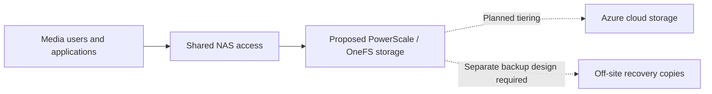
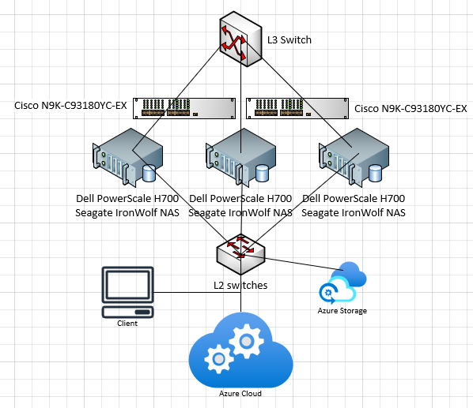

# Hybrid Storage Architecture Case Study

**SAIT · CMPH308 · August 2023 · Individual academic proposal**

**Storage planning · Scale-out NAS · Dell PowerScale / OneFS · Azure · Business continuity**

Designed a storage proposal for a fictional digital media business with 200 employees and 200 TB of data spread across five servers. The goal was to replace isolated direct-attached storage with shared storage that could support three years of growth, simpler access, and a recovery strategy.

The proposal explored a Dell PowerScale / OneFS NAS platform with Azure storage for off-site data. This case study preserves the design intent and adds a retrospective review of capacity, recovery, and cost assumptions. It documents planning work; no hardware purchase, deployment, or recovery test is evidenced in the retained material.

## My work

- Translated the business scenario into storage, growth, access, and recovery requirements.
- Proposed shared NAS with cloud storage and redundant network connections.
- Developed a topology, equipment list, implementation schedule, and training plan.
- Set recovery objectives and outlined backup, restoration, and support activities.
- Prepared a cost breakdown covering hardware, software, installation, and training.

## Business requirements

| Requirement | Planning baseline |
| --- | --- |
| Organization | Fictional digital media company with 200 employees |
| Starting dataset | 200 TB across five servers |
| Growth | 20% annually over a three-year planning period |
| Existing storage | Isolated direct-attached storage |
| Recovery point objective | 24 hours, proposed target |
| Recovery time objective | 4 hours, proposed target |

The recovery objectives were design targets, not measured results.

## Architecture concept

This is a portfolio summary of the proposed relationships, not a validated wiring diagram. Cloud tiering and recoverable backups need separate design decisions.

## Capacity planning

At 20% annual growth, the dataset reaches **345.6 TB after three years**.

| Planning year | Projected logical data |
| --- | ---: |
| Starting point | 200 TB |
| Year 1 | 240 TB |
| Year 2 | 288 TB |
| Year 3 | 345.6 TB |

The original drive calculation was **16 × 22 TB = 352 TB raw**. That leaves only 6.4 TB above the projected dataset before accounting for protection, filesystem overhead, snapshots, and operating headroom. It does not establish enough usable capacity for the requirement. A supported hardware configuration and usable-capacity model would be needed before procurement.

## What this project demonstrates

Experience turning a business problem into an infrastructure proposal: connecting growth assumptions to capacity, comparing shared storage with DAS, considering access and resilience, and budgeting for implementation and training.

The retrospective review is also useful: the original proposal mixed cloud tiering with backup, did not prove its recovery target, and contained inconsistent costs. Those gaps are recorded in the [design review](docs/design-review.md), with clear next steps rather than claims of a finished production solution.

## Detailed evidence

Original proposed topology

Retained from the proposal. The diagram shows the intended NAS, networking, client access, and Azure components. Switch roles, counts, and connection paths are not fully consistent with the written equipment list; this is evidence of the original concept, not implementation validation.

Capacity and cost calculations

The [capacity calculation](docs/capacity-model.csv) reproduces the three-year growth model using decimal TB. The [cost reconciliation](docs/cost-reconciliation.csv) records the original category figures alongside recalculated totals.

The proposal's category figures sum to CAD 818,508.68. Its recorded line items sum to CAD 799,534.70. These are historical proposal figures, not current prices or an approved quote.

Design review and evidence boundaries

Read the [design review](docs/design-review.md) for the source basis, capacity gaps, recovery considerations, cost discrepancies, and proposed validation steps.

The original Word and PDF files remain private. This repository contains a new summary, one reviewed topology image, and reproducible calculations. Contact fields, template correspondence, and course instructions are excluded.

## Project status

Historical design exercise with a retrospective technical review prepared for this portfolio. The retained proposal is dated August 2023. Implementation phases described in the proposal are planned activities; no measured performance, successful failover, completed migration, or recovery result is claimed.
